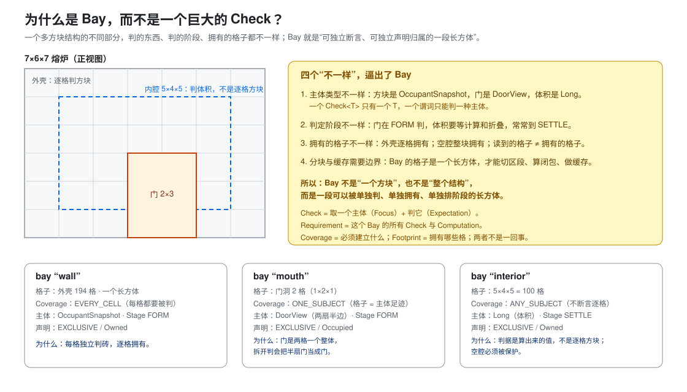
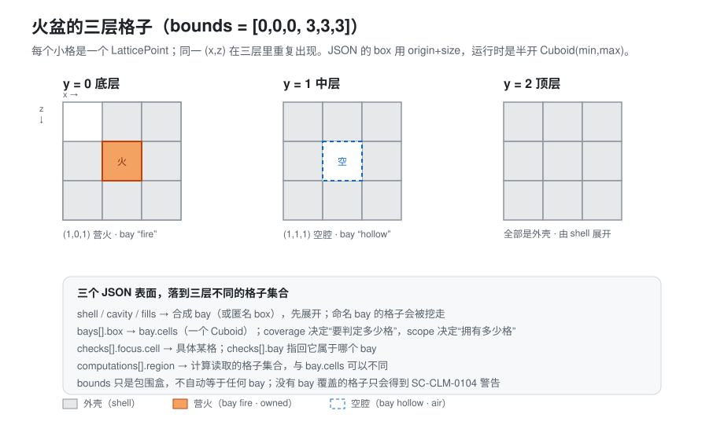
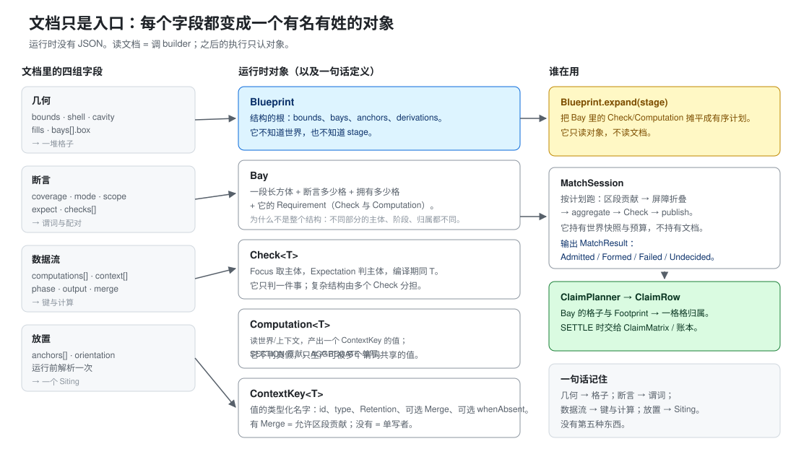
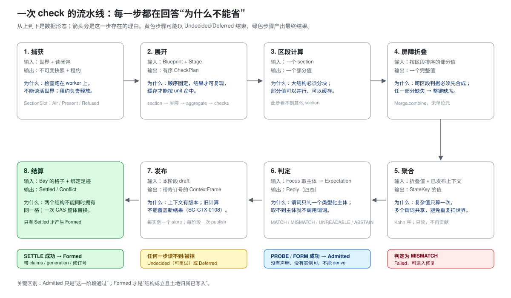

# StructureCumulus 上手与系统导览

这份文档回答两个问题：**怎么写一个结构**，以及**它背后有哪些系统、各自负责什么**。
内容对应当前代码，不写尚未存在的 API。

> 当前状态（2026-10-21）
>
> - `compileKernelJava`、`kernelPurity`：通过。
> - `src/kernelTest/.../examples/`：31 个编译错误，全部是旧示例与严格签名的差集，**预期为红**。
> - 数据包 JSON 的**加载器尚未实现**；下文的 JSON 是已定稿的格式，Java builder 才是今天能跑通的路径。

---

## 1. 先写一个结构

### 1.1 目标

一个 3×3×3 的火盆：

- 四周一圈石砖，中间是空气；
- 中心格必须是点燃的营火；
- 记录“内部空气格数”，并把它发布成运行时上下文。

定义空间以 `(0,0,0)` 为原点，`bounds = [0,0,0,3,3,3]`（`[x,y,z,sizeX,sizeY,sizeZ]`）。

### 1.2 数据包写法（格式已定，加载器待实现）

文件位置：`data/<namespace>/cumulus/structure/<name>.json`。

```json
{
  "schemaVersion": 2,
  "id": "mymod:campfire",
  "bounds": [0, 0, 0, 3, 3, 3],
  "shell": [
    {"box": [0,0,0,3,3,3], "block": "minecraft:stone_bricks"}
  ],
  "bays": [
    {"id": "hollow", "box": [1,1,1,1,1,1], "coverage": "every_cell",
     "sharing": "exclusive", "footprint": "box", "expect": {"air": true}},
    {"id": "fire", "box": [1,0,1,1,1,1], "coverage": "every_cell",
     "sharing": "exclusive", "footprint": "box",
     "expect": {"block": "minecraft:campfire"}}
  ],
  "checks": [
    {"id": "lit", "bay": "fire",
     "focus": {"kind": "occupant", "cell": [1,0,1]},
     "expect": {"kind": "state", "property": "lit", "value": "true"}}
  ],
  "computations": [
    {"id": "air_cells", "phase": "section", "bay": "hollow",
     "output": "mymod:air_cells", "kind": "count", "args": {"mode": "air"}}
  ],
  "context": [
    {"id": "mymod:air_cells", "type": "long", "retention": "context", "merge": "sum"}
  ],
  "anchors": [
    {"role": "front", "property": "facing", "value": "north"}
  ],
  "orientation": {"front": "north"}
}
```

字段含义：

| 字段 | 作用 |
| --- | --- |
| `bounds` | 结构的包围盒，所有局部坐标都相对它 |
| `shell` / `cavity` / `fills` | 几何声明；先于 `bays` 展开，命名 bay 会把格子从中挖走 |
| `bays[]` | 断言单元：一个长方体 + 覆盖方式 + 声明方式 + 期望 |
| `coverage` | `every_cell`（每格都要被判定）/ `one_subject`（格子等于主体足迹）/ `any_subject`（只断言存在或状态） |
| `sharing` / `footprint` | `exclusive`/`shared` × `box`/`bound`/`declared`/`none` |
| `checks[]` | 结构级检查；`bay` 指定它属于哪个舱位，`focus` 取主体，`expect` 判定 |
| `computations[]` | `phase: section` 每区段产一个部分值，`phase: aggregate` 折叠后算一次 |
| `context[]` | 上下文键声明；有 `merge` 表示允许区段贡献 |
| `anchors` | 锚点声明；读取格固定为定义原点，`property`/`value` 决定朝向 |

### 1.3 现在能跑的 Java 写法

同样的结构，用 `kernel` 的 builder 写：

```java
NamespacedId ID = NamespacedId.of("mymod", "campfire");
Cuboid bounds = Cuboid.of(0, 0, 0, 3, 3, 3);

// 1) 一个可贡献的上下文键：区段各产一个 long，提交时求和
ContextKey<Long> AIR = ContextKeys.of(
        NamespacedId.of("mymod", "air_cells"), Long.class,
        Retention.CONTEXT, Merges.sum(), null);

// 2) 区段计算：每个区段数一次空气格
Computation<Long> airCells = new Computation<>() {
    public NamespacedId id() { return NamespacedId.of("mymod", "air_cells"); }
    public Stage stage() { return Stage.FORM; }
    public StatePhase phase() { return StatePhase.SECTION; }
    public ContextKey<Long> output() { return AIR; }
    public Set<ContextKey<?>> inputs() { return Set.of(); }
    public CuboidSet region() { return CuboidSet.of(Cuboid.of(1, 0, 1, 2, 3, 2)); }
    public Outcome<Long> compute(ComputationContext ctx) {
        long n = ctx.section().cells().volume() - ctx.section().occupants().size();
        return new Outcome.Found<>(n, List.of(), FindingBundle.empty());
    }
};

// 3) 舱位：先拿到 bay 句柄，再建 check，最后 attach
BayBuilder fire = BayBuilder.start(
        NamespacedId.of("mymod", "fire"),
        Cuboid.of(1, 0, 1, 2, 1, 2),
        Coverage.EVERY_CELL, new Footprint.Bound(), Sharing.EXCLUSIVE);

Expectation<OccupantSnapshot> isCampfire =
        Expectations.block(NamespacedId.of("minecraft", "campfire"));

Check<OccupantSnapshot> lit = new Check<>(
        NamespacedId.of("mymod", "lit"), fire.bay(),
        Focuses.occupant(LatticeKey.of(LatticePoint.of(1, 0, 1))), isCampfire, null);

Bay fireBay = fire.attach(new Requirement(List.of(lit), List.of(airCells)));

// 4) 蓝图
Blueprint blueprint = new BlueprintBuilder(ID)
        .bounds(bounds)
        .bay(fireBay)
        .anchor(NamespacedId.of("mymod", "front"),
                NamespacedId.of("minecraft", "facing"), "north")
        .build();

// 5) 只读地检查一次：不改账本，得到判定、计划声明与读到的账本版本
StructureKernel kernel = StructureKernel.create(Catalogs.empty(), new InMemoryClaimLedger());
SnapshotInfo info = SnapshotInfo.of(0L, Ticket.of(1),
        new SnapshotId(NamespacedId.of("minecraft", "overworld"), 1L), 0L, true);
MatchResult result = kernel.check(new MatchRequest(info, blueprint,
        Siting.of(LatticePoint.ORIGIN, Orientation.IDENTITY), lease,
        MatchPolicy.defaults(), InstanceBudget.unbounded(), pins,
        record, OwnerId.of(NamespacedId.of("minecraft", "overworld"), ID)), () -> info);

if (result instanceof MatchResult.Admitted admitted) {
    Long air = admitted.outcome().value(AIR);
} else if (result instanceof MatchResult.Dropped dropped) {
    dropped.findings().forEach(System.out::println);   // 快照在检查期间变了，本次不发布
} else if (result instanceof MatchResult.Failed failed) {
    failed.findings().forEach(System.out::println);
}
```

`lease` 是捕获租约，`pins` 是 `PinBudget`，`record` 是拥有这次捕获的 `InstanceRecord`。测试里用
`TestLease.captured(new SnapshotId(world, 1), worldView, bytes)`；生产环境由适配层提供。
`Catalogs.empty()` 只包含内核内置的 focus/expectation；自定义项要先
`Catalogs.builder()...build()` 再注册。

`check` 只读：它返回 `Admitted`，携带判定、计划声明（`Admitted.planned()`）与它读到的账本版本
（`Admitted.ledgerRevision()`）。要真正登记就再调一次
`kernel.settle(request, admitted.planned(), () -> info)`——只有 `settle` 会改账本，也只有它返回
`Formed`（`23`）。

### 1.4 这堆 JSON 到底映射成什么

#### 先讲背景：为什么不是一个巨大的 Check

判断一个 7×6×7 的熔炉，最直接的做法是“写一个方法扫完 294 格，返回是/否”。这条路在真实结构上会同时撞到四件事：

1. **判的东西不同**：外壳逐格判方块，门是两格一个整体，内腔判的是体积/空气比例。一个 `Check<T>` 只有一个主体类型 `T`，塞不进同一个谓词。
2. **判的阶段不同**：门在 `FORM` 就能判；体积要先分块算、再折叠，常常到 `SETTLE` 才有值。
3. **拥有的格子不同**：外壳逐格拥有；空腔整块拥有；读到的格子不等于拥有的格子。
4. **分块与缓存需要边界**：只有长方体边界才能切区段、算读闭包、按单元缓存。

于是有了 **Bay**：一段可以被单独判、单独拥有、单独排阶段的长方体。它不是“一个方块”，也不是“整个结构”。



这套拆法的术语对应关系：

| 术语 | 一句话 | 为什么需要它 |
| --- | --- | --- |
| `Bay` | 一段长方体 + 断言多少格 + 拥有多少格 + 它的 `Requirement` | 让不同主体/阶段/归属的部分各自独立 |
| `Coverage` | 一个 MATCH 断言了多少格（`EVERY_CELL`/`ONE_SUBJECT`/`ANY_SUBJECT`） | 防止“一格通过就代表整个舱位通过” |
| `Footprint` | 结算时拥有多少格（`Box`/`Bound`/`Declared`/`None`） | 读到的格子不等于拥有的格子 |
| `Focus<T>` | 从世界/上下文里取出一个类型化的主体 | 谓词不应该自己扫世界 |
| `Expectation<T>` | 对一个主体返回四态 `Reply` | 判定只做判定，不产生状态 |
| `Check<T>` | `Focus<T>` + `Expectation<T>` + 所属舱位 | 编译期钉死两边同一个 `T` |
| `Requirement` | 这个 Bay 的所有 Check 与 Computation | Bay 的完整断言与计算清单 |
| `Computation<T>` | 读世界/上下文，产出一个 `ContextKey` 的值 | 跨格、跨区段的值只算一次，供多个谓词共享 |
| `ContextKey<T>` | 值的类型化名字（id、type、保留策略、可选折叠） | 让“共享”有类型、有生命周期、有版本 |
| `ClaimRow` | 一格归哪个结构的哪个舱位 | 两个结构不能同时拥有同一格 |

#### 文档里的四组字段

先说结论：**一份结构文档同时写了四件事，它们最终都汇进同一个 `Blueprint` 对象图。**

```
一份 JSON
├─ 几何   shell / cavity / fills / bays[].box      →  格子集合（Cuboid / CuboidSet）
├─ 断言   bays[].coverage / sharing / footprint / expect   →  Bay + Check(Focus, Expectation)
├─ 数据流 computations[] / context[]                →  Computation + ContextKey + Merge
└─ 放置   anchors[] / orientation                   →  构造 Siting（只在运行前用一次）
```

#### 先看最小的一份

只关心“这面地板是不是石砖”，不需要计算、上下文、锚点：

```json
{
  "schemaVersion": 2,
  "id": "mymod:hearth",
  "bounds": [0, 0, 0, 3, 1, 3],
  "bays": [
    {"id": "floor", "box": [0,0,0,3,1,3], "expect": {"block": "minecraft:stone_bricks"}}
  ]
}
```

它只映射成：

- 一个 `Cuboid`（`bounds` 与 `box` 都是半开区间）；
- 一个 `Bay`，`cells = min(0,0,0)..max(3,1,3)`；
- 一个 `Check`，`Focuses.occupant(cell)`（逐格）或 `Focuses.bay()`（整舱）配一个
  `Expectations.block(...)`。

没有 computation、没有 context、没有 anchor，`expand(FORM)` 里就只有 checks 一段。

#### 每一块字段的去处

| JSON | Java 类型 | 运行时作用 | 现在是否真的执行 |
| --- | --- | --- | --- |
| `bounds` | `Cuboid` | 蓝图包围盒；不自动等于任何 bay | 是（builder） |
| `shell` / `cavity` / `fills` | 合成 `Bay` 或匿名 `Cuboid` | 先展开成格子，命名 bay 会挖走自己的格子 | 否（lowering 未实现） |
| `bays[].box` | `Cuboid cells` | 舱位断言/拥有的格子 | 是 |
| `coverage` | `Coverage` | 一个 MATCH 断言多少格 | 是 |
| `sharing` / `footprint` | `Sharing` / `Footprint` | 共享规则与拥有范围 | 是 |
| `bays[].expect` | `Expectation<?>` | 舱位级谓词 | 部分（内置谓词有，JSON 解析器未实现） |
| `checks[].focus` | `Focus<T>` | 从世界/上下文取主体 | 部分 |
| `checks[].expect` | `Expectation<T>` | 判主体 | 部分 |
| `computations[].phase` | `StatePhase` | section 贡献还是 aggregate 单写 | 是 |
| `computations[].output` | `ContextKey<T>` | 写哪个键 | 是 |
| `computations[].inputs` | `Set<ContextKey<?>>` | Kahn 依赖 | 是 |
| `computations[].region` | `CuboidSet` | 计算读取的格子 | 是 |
| `context[].retention` | `Retention` | 尝试 / 事实 / 上下文 | 是 |
| `context[].merge` | `Merge<T>` | 区段贡献如何折叠 | 是 |
| `anchors[]` | `AnchorSpec` | 在定义原点读属性，决定朝向 | 否（resolver 未实现） |
| `orientation.front` | 朝向策略输入 | 锚点朝向映射到作者正面 | 否 |

#### `bounds` 的六个数

`[a, b, c, d, e, f]` 是 **origin + size**，不是两个角：

| 位置 | 含义 |
| --- | --- |
| `a, b, c` | 原点（最小角），`x, y, z` |
| `d, e, f` | 尺寸，`sizeX, sizeY, sizeZ`，必须 > 0 |

运行时 `Cuboid` 是半开区间 `min`/`max`，所以：

```
min = (a, b, c)
max = (a+d, b+e, c+f)      // max 不包含
```

| 文档 | 等价 `Cuboid` | 体积 |
| --- | --- | --- |
| `[0,0,0, 3,3,3]` | `Cuboid.of(0,0,0, 3,3,3)` | 27 |
| `[3,1,0, 1,2,1]` | `Cuboid.of(3,1,0, 4,3,1)` | 2 |
| `[1,1,1, 5,4,5]` | `Cuboid.of(1,1,1, 6,5,6)` | 100 |

四个坑：

1. 后三个是尺寸，不是第二个角；
2. 半开：`[0,0,0,3,3,3]` 的坐标是 `x∈[0,3)`，不含 `x=3`；
3. `size` 为 0 或负是 `SC-DOC-0505`（`EmptyCuboid`）；
4. `bounds` 只是包围盒，不会自动变成 bay；bay/check 的坐标是同一套定义空间里的绝对局部坐标。

坐标顺序固定 `x, y, z`（Y 垂直）；折叠/遍历的规范序是 `(x, z, y)`，两者不是一回事。

#### `expect` 为什么写成 `{类型: 内容}`

这是一个**带标签的联合**（tagged union）：键就是标签，值就是实参。

```json
{"block": "minecraft:stone_bricks"}
```

精确等价于规范形：

```json
{"kind": "block", "args": "minecraft:stone_bricks"}
```

紧凑写法省掉 `kind`，是因为大多数期望只有一个谓词；但**一个对象只能有一个标签**，
`{"block": "...", "trait": "..."}` 不是隐式 AND，而是 `SC-DOC-0605`。

OR / AND / NOT 都是标签，内容是子期望：

```json
{"anyOf": [
  {"block": "minecraft:stone_bricks"},
  {"block": "minecraft:deepslate_bricks"}
]}
```

```json
{"allOf": [
  {"block": "minecraft:iron_bars"},
  {"trait": "structurecumulus:item_inventory"}
]}
```

```json
{"not": {"air": true}}
```

| 想要 | 写法 |
| --- | --- |
| 任一满足 | `anyOf: [ ... ]` |
| 全部满足 | `allOf: [ ... ]` |
| 不满足 | `not: { ... }` |
| 每一格满足任一 | `eachCell` + `anyOf` |
| 每一格同时满足 A 与 B | `eachCell` + `allOf` |

两条约束：

- 组合器的数组不能为空（`SC-DOC-0606`）；空集合的“全真/全假”会把错误藏起来。
- 同一个 `anyOf`/`allOf` 的子项必须共享主体类型：`block` 与 `trait` 都测
  `OccupantSnapshot`，可以混；`state` 测的是 `T`，不能同组，拆成两条 `checks[]`。

#### 空间上到底长什么样



三个 JSON 表面落在三层不同的格子集合上：`shell` 铺满，`bays.fire` 指向 `(1,0,1)`，
`bays.hollow` 指向 `(1,1,1)`；`bounds` 只是包围盒，不会自动变成任何一个 bay。

#### 从文本到对象



左列只是“读文本、调 builder”；中间是运行时真正持有的不可变对象，每个对象下面是一句话定义；
右列说明谁在用它。没有第四套语义，也没有把 JSON 留在运行时。

#### 一次 check 的八个步骤



每一步为什么不能省：

| 步 | 为什么存在 | 省掉会怎样 |
| --- | --- | --- |
| 捕获 | 检查在 worker 上跑，不能读活世界 | 读到半改的世界，结果不可复现 |
| 展开 | 固定顺序、固定读闭包 | 结果依赖执行顺序，无法缓存 |
| 区段计算 | 大结构分块，可并行、可缓存 | 一次扫完整结构，无法增量 |
| 屏障折叠 | 跨区段判据必须先合成 | 每个区段各自判，得到互相矛盾的结论 |
| 聚合 | 复杂值只算一次，多个谓词共享 | 每个谓词重扫 100 格，且可能算出不同值 |
| 判定 | 谓词只判一个类型化主体 | 谓词自己扫世界，无法组合、无法复用 |
| 发布 | 上下文有版本 | 旧的慢计算覆盖新结果 |
| 结算 | 两个结构不能同时拥有一格 | 两座炉子重叠，都显示“成立” |

#### 一格的一生：`(1,0,1)`

| 步骤 | 发生什么 | 代码里的对象 |
| --- | --- | --- |
| 1 | `bays.fire.box` 覆盖这一格 | `Bay.cells` 包含 `LatticePoint(1,0,1)` |
| 2 | 该格被判为营火 | `Check`：`Focuses.occupant(...)` + `Expectations.block(campfire)` |
| 3 | 取不到主体（区段被拒） | `Outcome.Missing` → `Reply.unreadable`，谓词不执行 |
| 4 | 取到但是石头 | `Reply.mismatch` → 一条 `Finding`，不写声明 |
| 5 | 取到且是营火 | `Reply.match`；`settle` 时生成 `ClaimRow(cell, EXCLUSIVE, owner, siting, fire)` |

所以“复杂”不是因为字段多，而是因为四个关注点被写在同一份文档里；真正常用的最小结构只有
`bounds` + `bays[].box` + `expect`。

---

## 2. 一次 `check` 发生了什么

```
WorldView ──▶ 捕获/租约 ──▶ plan(expand) ──▶ section 计算 ──▶ 屏障折叠
                                                              │
                    Formed ◀── 结算声明 ◀── 判定 ◀── aggregate 计算 ◀── checks
```

| 步 | 做什么 | 失败会怎样 |
| --- | --- | --- |
| 1. 计划 | `blueprint.expand(stage)` 把 section / aggregate / derivation / check 排成有序列表 | 环或重复产出者 → `Failed(SC-ENG-0102)` |
| 2. 区段 | 每个 `SECTION` 计算按区段跑，`draft.forSection(key).contribute(...)` 写入部分值 | 区段被拒 → `draft.refuse(key)` |
| 3. 折叠 | 按 `SectionKey (x,z,y)` 排序，`Merge.combine` 左折；任一部分缺失 → 整键缺席 | 缺席进 `Outcome.Missing`，不是 0 |
| 4. 聚合 | `AGGREGATE` 计算读折叠值，`draft.put(key, value)` | 预算耗尽 → `Undecided(BUDGET_EXHAUSTED)` |
| 5. 判定 | 每个 `Check` 先 `focus.take`，有主体才调 `expectation.test`，`Reply.combine` 汇总 | `UNREADABLE > MISMATCH > ABSTAIN > MATCH` |
| 6. 发布 | 一个 stage 一个 draft，`store.publish(draft)` | 基修订过期 → `Undecided(DIRTY_UNSTABLE)` |
| 7. 结算 | `settle` 生成 `ClaimRow`，一次 CAS 写账本 | 冲突 → `Failed(SC-CLM-0002)`；修订被移动 → 一次重试后 `Undecided(LEDGER_MOVED)` |

只有第 7 步（`settle`）成功才会得到 `Formed`；只读的 `check` 最多得到 `Admitted`。

---

## 3. 系统导览

### 3.1 空间与朝向

- `LatticePoint` 整数格；`LatticeKey` 把 `(x:26, z:26, y:12)` 打包成 `long`；
- `Cuboid` 是**半开区间**：`Cuboid.of(0,0,0, 3,3,3)` 体积 27；
- `CuboidSet` 是规范形：不相交、排序、重叠合并；**相接但不相交的盒子保持分开**；
- `Orientation` 是 48 元群，`Turn`/`Tilt`/`Flip` 生成；
- `Siting` = 原点 + 摆放；`toWorld`/`toLocal` 做局部↔世界；
- 锚点读取格固定为定义原点，候选朝向必须满足
  `candidate.apply(authoredFront) == anchorHeading`。

### 3.2 占用体与快照

- `WorldView` 是只读面：`slot(SectionKey)`、`occupant(cell)`、`occupants(box, filter)`、`contentDigest`；
- `SectionSlot` = `Air` / `Present(SectionSnapshot)` / `Refused(status, code)`；
- 空气是**可读**占用体，`Refused` 永远不是空气；
- `OccupantRef` 自带它被铸造时所处的 `SnapshotId`，足迹属于 `OccupantSnapshot`；
- 实体窗口 `EntityWindow` 是声明区域外扩 `MAX_ENTITY_SPAN = 3` 格。

### 3.3 谓词：`Expectation<T>`

```java
interface Expectation<T> {
    Reply test(ExpectationContext<T> ctx);
    Class<T> subject();
    default ReadScope reads() { return ReadScope.none(); }
    default ExpectationMeta meta();
}
```

- `T` 是被测主体：`OccupantSnapshot`、`BayView`、`DoorView`、`Long`（上下文值）……
- `Reply` 只有四态：`Match` / `Mismatch` / `Unreadable` / `Abstain`；
- 谓词**只判定**，不读世界、不写上下文；
- `Focus<T>` 负责“取主体”：`take` 返回 `Outcome<T>`，缺席是 `Missing`，不是 null；
- `Check<T>` 把 `Focus<T>` 与 `Expectation<T>` 钉在同一个 `T` 上，构造器校验 `SC-CHK-0101`。

### 3.4 中间状态与上下文：`ContextKey<T>`

```java
record ContextKey<T>(NamespacedId id, Class<T> type, Retention retention,
                     @Nullable Merge<T> merge, @Nullable T whenAbsent) {}
```

- `merge == null`：单写者，用 `draft.put`；
- `merge != null`：区段可贡献，用 `draft.forSection(sectionKey).contribute`；
- `Retention`：`ATTEMPT` 随尝试丢弃，`OUTCOME` 进 `MatchOutcome`，`CONTEXT` 发布到 tier frame；
- 折叠只保留一份，在 `ContextDraft` 内；`AggregateContext.read` 读到的就是它；
- 区段被拒时 `draft.refuse(key)`；全部可读但无贡献时 `draft.declined(key)` 才走 `whenAbsent`。

谓词读上下文：

```java
Focus<Long> air = Focuses.context(AIR);
// 内部就是 ctx.context().require(AIR)：缺席 → Outcome.Missing → Reply.unreadable
```

### 3.5 蓝图、舱位与计划

- `Blueprint` = `(id, bounds, bays, anchors, derivations)`；
- `Bay` = `(id, cells, Coverage, Footprint, Sharing, Requirement, description)`；
- `Requirement` = `List<Check<?>>` + `List<Computation<?>>`，不能为空；
- `expand(stage)` 的顺序：section 计算 → 屏障 → aggregate + derivation（Kahn）→ checks；
- 同一阶段的并列项按声明序（舱位先，然后各自的 `Requirement` 顺序）。

`Coverage` 与 `Footprint` 的组合只受 R1–R4 约束：

| Coverage | 含义 |
| --- | --- |
| `EVERY_CELL` | 每个格子都要被某个检查判定 |
| `ONE_SUBJECT` | 格子等于绑定主体的足迹并集 |
| `ANY_SUBJECT` | 不断言格子，只断言存在或状态 |

R1（构建）`EXCLUSIVE` 的足迹不能是 `None`（`SC-CHK-0106`）；R2（结算）`EXCLUSIVE` + `Bound`
必须解析出至少一格（`SC-BAY-0111`）；R3（构建 + 结算）`ONE_SUBJECT` 要求检查都是主体类，且
绑定足迹等于舱位（`SC-BAY-0107`）；R4（构建）`EVERY_CELL` 要求逐格检查覆盖舱位。

### 3.6 声明

- `ClaimRow(cell, sharing, owner, siting, bay)`；
- `ClaimMatrix.conflicts(a,b)` 是唯一冲突谓词；同 `(owner, siting)` 不比较；
- `check` 只读；声明只由 `settle` 写入，`settle` 替换该 `(owner, siting)` 的全部行，一次 CAS；
- `release(owner, siting)` 注销该键的全部行（`23` §5）；
- `Settled` / `ClaimConflict` / `RevisionMoved` 三种裁决；
- `Bound` 只拥有**非空气**的绑定足迹；要保护空腔必须显式 `Box`。

### 3.7 结果与诊断

```java
sealed interface MatchResult permits Admitted, Dropped, Formed, Failed, Undecided, Deferred
```

| 分支 | 含义 |
| --- | --- |
| `Admitted` | `check` 通过：判定 + 计划声明 + 读到的账本版本；没有实例 id，不能 `derive`，不写账本 |
| `Dropped` | 快照在检查与结算之间变了；没有写入 |
| `Formed` | 只有 `settle` 产出；带 `claims`、`generation`、`contextRevision`、`ledgerRevision` |
| `Failed` | 世界确实不满足；可进入修复 |
| `Undecided` | 读不到/预算耗尽/声明被抢/基修订过期；带原因与可选重试令牌 |
| `Deferred` | 没有执行，带重试令牌 |

`Finding` 是 9 组件记录：`id, code, severity, message, labels, notes, suggestion, related, stage`。
`FindingBundle` 按 severity → stage → code → 主 locus → 插入序排序，并按值去重。

### 3.8 补救（设计态）

`Repair` / `Preview` / `EditPlan` / `PlanValidator` 仍只在规范里；当前内核没有实现。
已经实现的是 `RemedyContext` 的数据形状与 `SC-RMD-0309` 的规则：修复计划不能改变它自己读取的上下文键。

---

## 4. 写一个自定义谓词

```java
static final FindingCode UNLIT = FindingCode.of(FindingCode.Family.EXP, 100);

static Expectation<OccupantSnapshot> litCampfire() {
    return new Expectation<>() {
        public Class<OccupantSnapshot> subject() { return OccupantSnapshot.class; }

        public Reply test(ExpectationContext<OccupantSnapshot> ctx) {
            boolean lit = ctx.subject().hasTrait(NamespacedId.of("minecraft", "lit"));
            return lit ? Reply.match()
                       : Reply.mismatch(Finding.builder(UNLIT).severity(Severity.ERROR)
                               .message("the campfire is not lit")
                               .label(ctx.locus(), "not lit").stage(ctx.stage()).build());
        }
    };
}
```

要点：

- `subject()` 必须如实返回；`Check` 用它做构造期校验；
- 谓词只读 `ctx.subject()` / `ctx.context()`，不读 `WorldView`；
- 失败要有 `Finding`，不要返回 `null`。

---

## 5. 写一个自定义计算

```java
final class AirCells implements Computation<Long> {
    public NamespacedId id() { return NamespacedId.of("mymod", "air_cells"); }
    public Stage stage() { return Stage.FORM; }
    public StatePhase phase() { return StatePhase.SECTION; }
    public ContextKey<Long> output() { return AIR; }
    public Set<ContextKey<?>> inputs() { return Set.of(); }
    public CuboidSet region() { return CuboidSet.of(INTERIOR); }

    public Outcome<Long> compute(ComputationContext ctx) {
        long n = ctx.section().cells().volume() - ctx.section().occupants().size();
        return new Outcome.Found<>(n, List.of(), FindingBundle.empty());
    }
}
```

- `SECTION`：`ctx.section()` 只看本区段，**没有** `read(ContextKey)`；
- `AGGREGATE`：`ctx.read(key)` 读折叠值，不能再 `contribute`；
- 一个计算只有一个 `output()`；多个结果拆成多个计算，用 `inputs()` 建依赖。

---

## 6. 严格实现的坑

这些是“照规范实现”时真实撞到的，不是使用者的错：

1. **`Check` 持有 `Bay`，`Bay` 又持有 `Requirement(Check)`**：不可变 record 无法构造，只能两阶段
   `BayBuilder.start(...).bay()` → `new Check(...)` → `attach(requirement)`；`Bay` 因此不是 record。
2. **`Cuboid` 是半开区间**：`of(1,1,1,5,4,5)` 体积是 4×3×4，不是 5×4×5；要 100 格写 `(1,1,1,6,5,6)`。
3. **相接盒子不合并**：两个贴合的盒子仍是两个；区域相等要用双向 `containsAll`，不要用 `equals`。
4. **区段贡献必须带区段身份**：`draft.forSection(sectionKey).contribute(...)`；直接 `draft.contribute` 只存在于文档。
5. **区段被拒不是 0**：`refuse(key)` 后整键缺席，`require` 返回 `Missing`，谓词不会被调用。
6. **`Coverage.EVERY_CELL` 的格子目前不进脏标记**：`Focuses.bay()/allCells()` 的 `ReadScope` 是空的，
   所以 EVERY_CELL 的读范围不会触发 `DirtyIndex.cellStamp`。这是已知缺口。
7. **`Formed` 需要租约**：构造 `MatchRequest` 必须给 `SnapshotLease`；`Formed.close()` 释放子句柄。
8. **`generation` 跨尝试没有持有者**：默认每次从 1 开始；`DIRTY_UNSTABLE` 的重发需要宿主把上一
   个 `Formed` 交给 `InstanceRecord`。
9. **JSON 加载器未实现**：`schemaVersion 2` 的格式已定，但 `10-documents` 里的 compiler 还没有代码。
10. **示例当前是红的**：31 个错误是旧示例与严格签名的差集，用来固定“哪些签名变了”。

---

## 7. 跑起来

```bash
cd Project/StructureCumulus

./gradlew compileKernelJava     # 内核主源集
./gradlew kernelPurity          # 禁止 MC/NeoForge/Mojang
./gradlew compileKernelTestJava # 当前 31 个错误，全部在 examples/
./gradlew kernelTest            # 测试红是预期
```

审阅入口：

- `src/kernel/java/dev/vfyjxf/cumulus/kernel/`：`base space occupant context predicate blueprint claim engine spi`
- `src/kernelTest/java/dev/vfyjxf/cumulus/kernel/examples/TestWorld.java`：一个可构造的 `WorldView`
- `build/reports/tests/kernelTest/index.html`：测试报告

---

## 8. 术语速查

| 术语 | 一句话 |
| --- | --- |
| 蓝图 `Blueprint` | 一个结构的完整声明：包围盒、舱位、锚点、派生 |
| 舱位 `Bay` | 一个长方体断言单元，带覆盖方式与声明方式 |
| 焦点 `Focus` | 从世界/上下文里取出被测主体 |
| 谓词 `Expectation` | 对一个类型化主体返回四态 `Reply` |
| 检查 `Check` | 焦点 + 谓词 + 所属舱位，编译期同型 |
| 计算 `Computation` | 产出 `ContextKey` 的值；分 section 与 aggregate |
| 上下文键 `ContextKey` | 唯一的类型化键；可单写，也可由区段贡献 |
| 折叠 `Merge` | 把按区段排序的部分值合成一个值 |
| 保留 `Retention` | 值的生命周期：尝试 / 事实 / 上下文 |
| 声明 `Claim` | 一格归哪个结构的哪个舱位；共享规则只有排他/共享两种 |
| 结果 `MatchResult` | Admitted / Dropped / Formed / Failed / Undecided / Deferred |
| 诊断 `Finding` | 带 code、severity、label、suggestion 的结构化错误 |
